## Olá! Eu sou o Arthur 👋
<ul style="list-style: none; padding-left: 0;">
  <li>🖥️ <strong>Desenvolvedor de Software Jr. | QA Jr.</strong> — Estagiário de Desenvolvimento no <strong>Grupo Zaffari</strong>, atuando no time de <strong>aplicações de IA</strong></li>
  <li>🎓 Estudante de <strong>Análise e Desenvolvimento de Sistemas</strong> – Uniasselvi</li>
  <li>🤖 Foco atual em <strong>Inteligência Artificial Generativa</strong>, com experiência anterior em <strong>Mobile</strong> e conhecimentos em <strong>Web e Backend</strong></li>
  <li>🚀 Tecnologias em prática: <strong>JavaScript, TypeScript, React, React Native, Vite, Node.js</strong></li>
  <li>🧪 Conhecimentos em <strong>QA</strong>: testes funcionais e homologação</li>
  <li>🔧 Versionamento e colaboração com <strong>Git & GitHub</strong></li>
</ul>

  
  

    

  

---
## 📌 Sobre mim

Desenvolvedor Jr. e Estagiário de Desenvolvimento no <strong>Grupo Zaffari</strong>, atuando no time de <strong>aplicações de IA</strong>. 
Como Jovem Aprendiz, fiz parte do time de <strong>Mobilidade</strong> da empresa, onde adquiri experiência em desenvolvimento mobile com <strong>React Native</strong>.
  
Tenho conhecimentos em <strong>QA</strong> (testes funcionais e homologação), além de experiência prática em <strong>JavaScript, TypeScript, React, React Native e Node.js</strong>, 
aplicando lógica de programação, versionamento com <strong>Git/GitHub</strong> e boas práticas de desenvolvimento. Também possuo conhecimentos em Front-end com 
<strong>React + Vite, HTML e CSS</strong>, além de <strong>Java e Spring Framework</strong>.
  
Atualmente curso <strong>Análise e Desenvolvimento de Sistemas</strong> na <strong>UNIASSELVI</strong>, 
aliando formação acadêmica à prática constante em projetos e estudos contínuos em Inteligência Artificial.

---

## 🛠️ Tecnologias & Ferramentas

  
  
  
  
  
  
  
  
  
  
  
  

  
  
  
<i>"Aprendizado constante é a base para construir boas soluções."</i>

  <picture>
    <source media="(prefers-color-scheme: dark)" srcset="https://raw.githubusercontent.com/Arthur-018/Arthur-018/output/pacman-contribution-graph-dark.svg">
    <source media="(prefers-color-scheme: light)" srcset="https://raw.githubusercontent.com/Arthur-018/Arthur-018/output/pacman-contribution-graph.svg">
    
  </picture>

